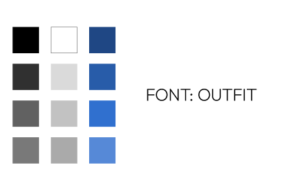
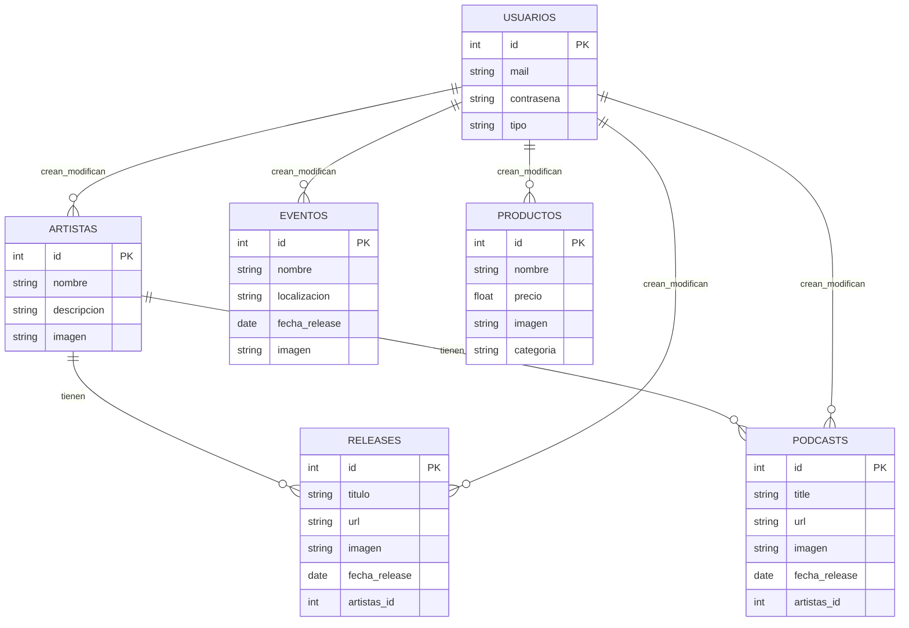

# Diseño

## Esquema (boceto o wireframe).

https://app.mockflow.com/view/Mb6449180842d0cff1bbe658e1386800a1773158697960

## Identidad visual 

El azul es el color principal. El negro también es importante porque representa la parte oscura y industrial de la música techno. El blanco se utiliza para crear contraste con los fondos oscuros. La fuente que se usa se llama Outfit. Esta fuente es moderna, limpia y digital, lo que va muy bien con la estética del proyecto.

## Diagrama de Bases de Datos

